# DSO202 — Practical 4 Report
## GitOps with Argo CD on a Kind Cluster

---

## 1. Objective

This practical replaces "push" deployment (an engineer or a CI server running `kubectl apply`) with **GitOps**. A GitHub repository is the single source of truth, and **Argo CD**, a controller running *inside* the cluster, continuously pulls the desired state from Git and reconciles the cluster to match it.

It follows the *GitOps and Argo CD Lab Guide* on the three-node `kind` cluster `dso202` from Practical 1:

1. Verifying the multi-node Kind cluster (1 control plane, 2 workers)
2. Installing Argo CD into its own `argocd` namespace and waiting for every component to become Ready
3. Accessing Argo CD: decoding the initial `admin` password, `kubectl port-forward` to `argocd-server`, and logging in
4. Building the GitOps config repository: `manifests/deployment.yaml` (2 replicas of `nginxdemos/hello:plain-text`) and `manifests/service.yaml`, committed and pushed to GitHub
5. Declaring the Argo CD `Application` itself as YAML (`argocd-app.yaml`) with automated sync, `prune`, `selfHeal` and `CreateNamespace=true`, and checking that it deploys and is `Synced`/`Healthy`
6. Scaling the GitOps way: changing `replicas: 2 → 4` in Git and letting Argo CD apply it
7. Self-healing: a "rogue admin" `kubectl scale --replicas=1` that Argo CD reverts automatically
8. Pruning: deleting `service.yaml` from Git removes `webapp-svc` from the cluster, and a `git revert HEAD` brings it back
9. Troubleshooting: reproducing the guide's `ComparisonError` row with a deliberately wrong `path:`

---

## 2. Environment

| Component | Value |
|---|---|
| Host OS | Kali GNU/Linux Rolling, kernel `7.1.5+kali-amd64` |
| Container runtime | Docker Engine `29.9.2` (native daemon) |
| Cluster | `kind` v0.32.0 cluster `dso202` from Practical 1; context `kind-dso202` |
| Kubernetes | `v1.36.1` on `control-plane`, `worker-node-1`, `worker-node-2` |
| kubectl | `v1.36.5` |
| Argo CD | **`v3.6.1`** (official `stable` `install.yaml`): `quay.io/argoproj/argocd:v3.6.1`, `dex v2.46.0`, `redis 8.10.1-alpine` |
| Argo CD CLI | `argocd v3.6.1`, copied out of the same Argo CD image |
| GitOps repository | **`https://github.com/DechenWangdraSherpa/DSO202-Practical4.git`** (public), branch `master`, path `manifests/` |
| Application image | `nginxdemos/hello:plain-text` |
| Target namespace | `demo-app` (created by Argo CD through `CreateNamespace=true`) |

**Deviations from the notes, and why:**

- **The GitOps repo is `DSO202-Practical4` (branch `master`), not `dso202-gitops-demo` / `k8s-gitops-demo` (branch `main`).** I used this practical's own public GitHub repository. Argo CD only reads the `path: manifests` folder, so the report, screenshots and PDFs in the repository root are never deployed. `targetRevision: HEAD` follows the default branch, so the branch name doesn't matter. Only the lab's own changes to `manifests/` were committed and pushed during the practical (5 commits, screenshot 12).
- **Argo CD was installed with server-side apply.** The guide's plain `kubectl apply -n argocd -f …/stable/manifests/install.yaml` created everything except the `applicationsets.argoproj.io` CRD. That CRD is so large that client-side apply's `last-applied-configuration` annotation exceeds the 262144-byte limit. Re-running with `--server-side --force-conflicts`, which upstream Argo CD now documents, applied it. The failing output is kept in `evidence/argocd-install-client-side.log`.
- **The cluster needed repairing first.** On the `dso202` cluster, `kube-proxy` was in `CrashLoopBackOff` with `too many open files`, and CoreDNS was not Ready. The host's `fs.inotify.max_user_instances` is only 128, and the running `floci` course containers (including an EKS emulator cluster) were using up the shared inotify instances. Raising the sysctl needs sudo, so I stopped the `floci-*` containers with `docker stop` instead (they can be brought back with `docker start`) and recreated the kube-proxy pods. After that the cluster was healthy.
- **Terminal evidence instead of browser screenshots of the Web UI.** The UI was reachable through the port-forward (`https://localhost:8080` returned `200 text/html`, screenshot 4). For evidence I used the `argocd` CLI, which talks to the same API server as the UI. `argocd app get` shows the Sync/Health badges and per-resource status, `argocd app resources --output tree` shows the same Application → Deployment → ReplicaSet → Pods tree the UI draws, and `argocd app get --refresh` is the UI's **Refresh** button.
- **Kubernetes `v1.36.1`** instead of the guide's `v1.31.0`, and **Argo CD v3.6.1** (the current `stable`). The `Application` API (`argoproj.io/v1alpha1`) is unchanged.
- The cluster also contains Argo **Workflows** CRDs (`workflows.argoproj.io`, …) from the `my-argo` release in `dso202-helm`. They share the `argoproj.io` API group but are a different product, and I left them untouched.

### Repository layout

```
DSO202-Practical-04/                   (= github.com/DechenWangdraSherpa/DSO202-Practical4)
├── README.md                          ← this report
├── manifests/                         ← Argo CD's source path (the desired state)
│   ├── deployment.yaml                ← webapp-deploy, replicas: 4 after Task 6
│   └── service.yaml                   ← webapp-svc (deleted, then restored by git revert)
├── argocd-app.yaml                    ← the Application CR (applied with kubectl once)
├── troubleshooting/
│   └── broken-path-app.yaml           ← deliberate ComparisonError (path: manifest)
├── evidence/                          ← final Application YAML, live manifests, events, history, git log
└── screenshots/                       ← terminal evidence used below
```

---

## 3. Procedure and Observations

### Task 1 — Verifying the Kind cluster

```
kind get clusters
kubectl config current-context
kubectl get nodes -o wide
kubectl get pods -n kube-system -l k8s-app=kube-proxy
```

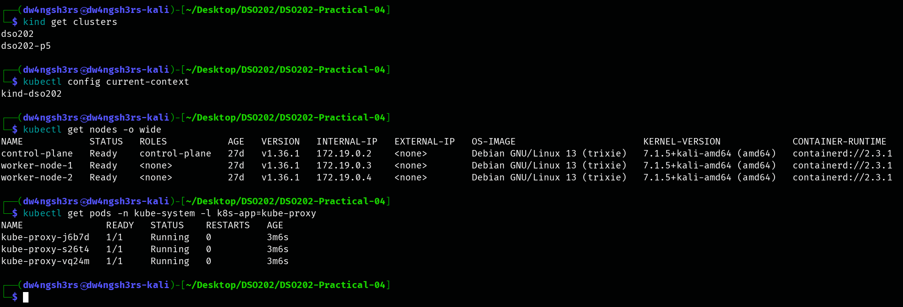

**Observation:** the guide asks for the same `dso202` cluster, and it has the expected topology: `control-plane` plus `worker-node-1` and `worker-node-2`, all `Ready` on `v1.36.1` with containerd 2.3.1. The kube-proxy pods are `Running` with `0` restarts and an age of about three minutes, because these are the pods I recreated after freeing inotify instances (see Deviations). Before that fix they had restarted more than 70 times.

### Task 2 — Installing Argo CD

```
kubectl create namespace argocd
kubectl apply -n argocd -f https://raw.githubusercontent.com/argoproj/argo-cd/stable/manifests/install.yaml
kubectl apply -n argocd --server-side --force-conflicts -f https://raw.githubusercontent.com/argoproj/argo-cd/stable/manifests/install.yaml
kubectl get crd | grep -E 'applications|appprojects'
```

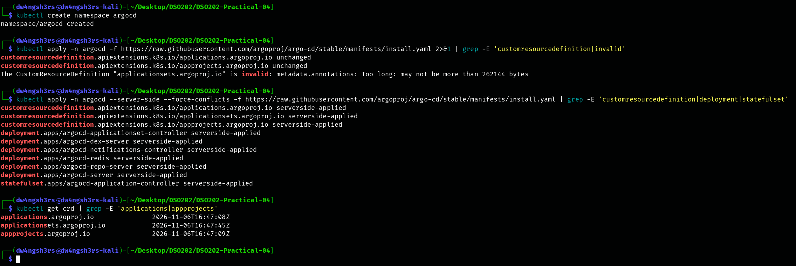

**Observation:** Argo CD gets its own `argocd` namespace. The guide's client-side `kubectl apply` created most objects but failed on one: `The CustomResourceDefinition "applicationsets.argoproj.io" is invalid: metadata.annotations: Too long: may not be more than 262144 bytes`. Client-side apply stores a full copy of every object in the `kubectl.kubernetes.io/last-applied-configuration` annotation, and this CRD's OpenAPI schema is larger than the annotation limit. Server-side apply keeps field ownership in `managedFields` on the server instead, so `--server-side` reported `serverside-applied` for all three CRDs, six Deployments and the `argocd-application-controller` StatefulSet.

The three CRDs are how Argo CD "teaches the Kubernetes API new words": `applications.argoproj.io` (`kind: Application`), `appprojects.argoproj.io` (`kind: AppProject`) and `applicationsets.argoproj.io`.

```
kubectl wait --for=condition=Ready pods --all -n argocd --timeout=300s
kubectl get pods -n argocd -o wide
kubectl get svc -n argocd argocd-server
```

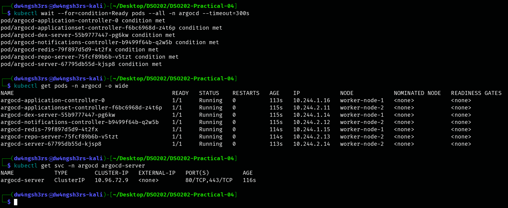

**Observation:** all seven pods reached `Ready`. The three components the guide highlights are there: `argocd-server` (API/Web UI), `argocd-repo-server` (clones Git and renders manifests) and `argocd-application-controller-0` (the reconciliation "brain", a StatefulSet). The others are support services: `redis` (cache), `dex-server` (SSO), `applicationset-controller` and `notifications-controller`. The pods are spread over both worker nodes. `argocd-server` is a `ClusterIP` Service on 80/443, so it isn't reachable from outside the cluster without a port-forward. The images had been pre-pulled on the host and loaded with `kind load docker-image`, so startup didn't depend on slow registry pulls.

### Task 3 — Accessing Argo CD (admin password, port-forward, login)

```
kubectl -n argocd get secret argocd-initial-admin-secret -o jsonpath="{.data.password}" | base64 -d; echo
kubectl port-forward svc/argocd-server -n argocd 8080:443 &
curl -sk https://localhost:8080/api/version | jq .
curl -sk -o /dev/null -w "%{http_code} %{content_type}\n" https://localhost:8080/
argocd login localhost:8080 --username admin --password "$(kubectl -n argocd get secret …)" --insecure
argocd account get-user-info
```

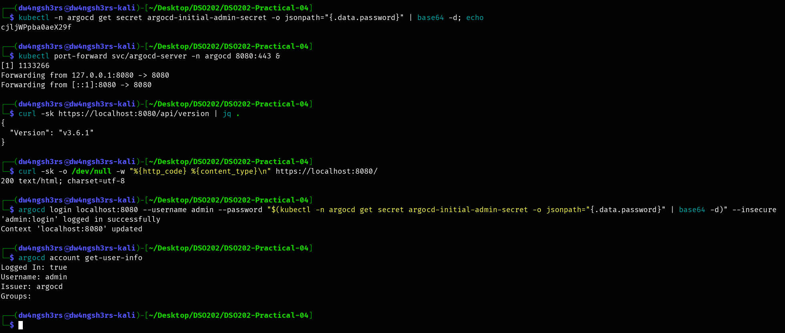

**Observation:** the initial `admin` password is stored base64-encoded in the `argocd-initial-admin-secret` Secret, and decoding it gives the login password. With `kubectl port-forward` forwarding local `8080` to the Service's `443`, the API reports `v3.6.1`, and `/` returns `200 text/html`, which is the Web UI that would open at `https://localhost:8080`. `curl -k` and `--insecure` are needed for the same reason the browser shows "Your connection is not private": out of the box Argo CD serves a **self-signed** TLS certificate. `argocd login` as `admin` succeeded (`Logged In: true`, issuer `argocd`). The port-forward was left running for the rest of the lab, like the guide's "separate terminal window".

### Task 4 — The GitOps configuration repository

```
git remote -v
tree manifests
cat manifests/deployment.yaml manifests/service.yaml
git add manifests
git commit -m "Initial deployment with 2 replicas"
git push origin master
git log --oneline
```

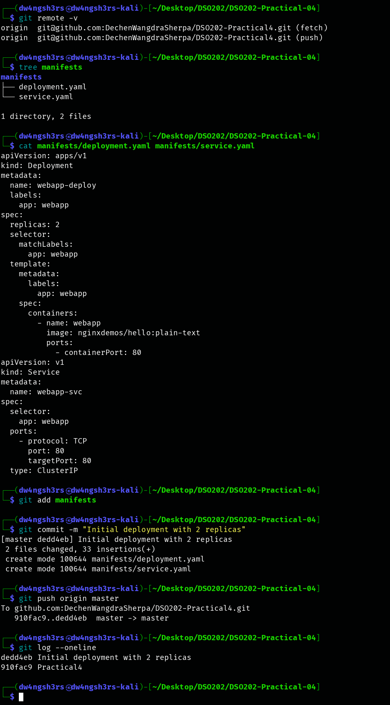

**Observation:** the repository contains only declarative facts: a Deployment `webapp-deploy` (2 replicas, label `app: webapp`, container port 80) and a ClusterIP Service `webapp-svc` that selects `app: webapp`. Before committing, I checked both files with `kubectl apply --dry-run=client`. The push moved `master` from `910fac9` to `dedd4eb`. From here on, that commit hash identifies the desired state, which is the "Versioned and Immutable" principle. Nothing has been applied to the cluster yet.

### Task 5 — Declaring the Argo CD Application as YAML

```
cat argocd-app.yaml
kubectl apply -f argocd-app.yaml
kubectl get applications -n argocd
```

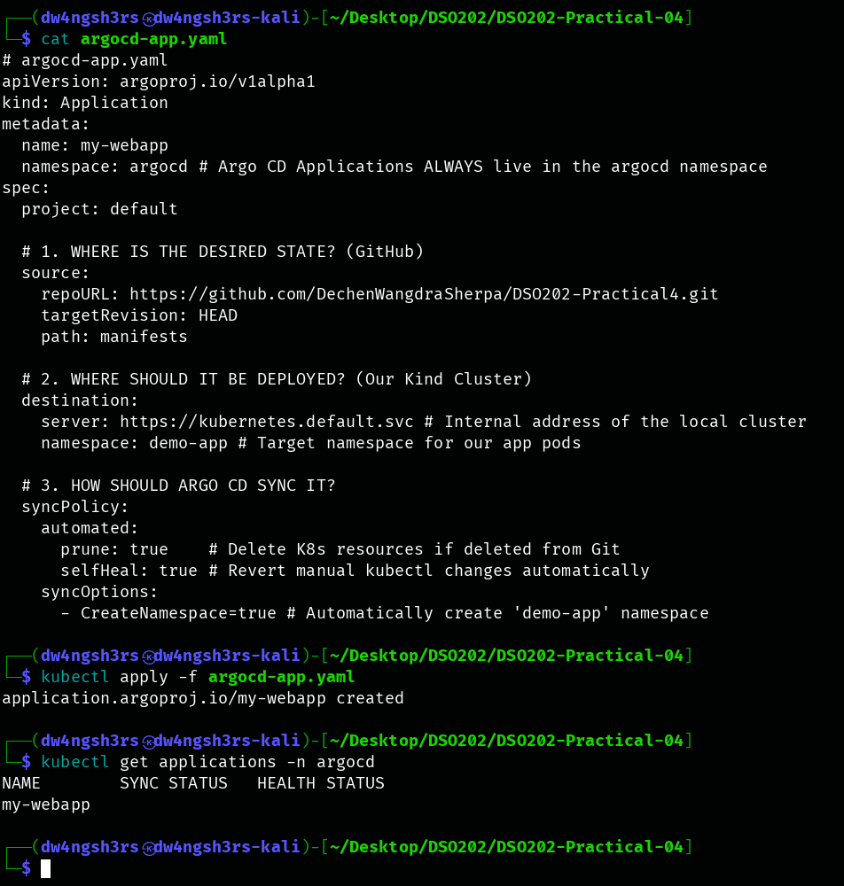

**Observation:** the `Application` is itself a Kubernetes object (a CR of the CRD installed in Task 2), so it is created with `kubectl apply` like any other manifest. It answers the guide's three questions: **where** the desired state is (`repoURL` + `targetRevision: HEAD` + `path: manifests`), **where** to deploy it (`https://kubernetes.default.svc`, which is this cluster, and namespace `demo-app`), and **how** to sync it (`automated` with `prune: true` and `selfHeal: true`, plus `CreateNamespace=true`). Straight after creation, `SYNC STATUS` and `HEALTH STATUS` are still empty, because the controller hasn't finished its first comparison yet.

```
argocd app get my-webapp
argocd app resources my-webapp --output tree
kubectl get pods -n demo-app -o wide
```

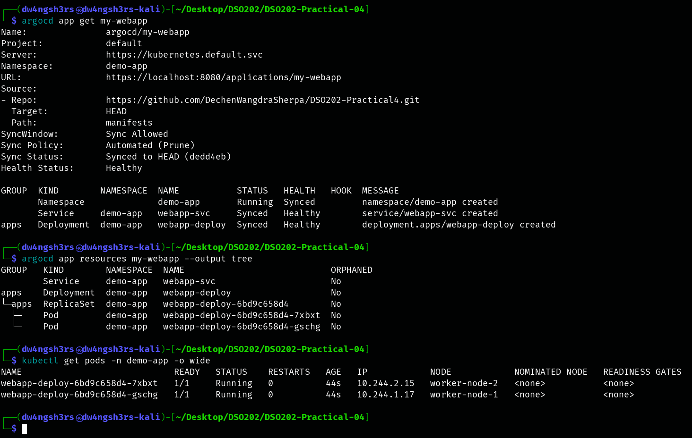

**Observation:** about 20 seconds later the application was **`Synced to HEAD (dedd4eb)`** and **`Healthy`**. Nobody ran `kubectl apply` on the manifests: Argo CD's repo-server cloned the public repo with no credentials, rendered `manifests/`, and the application controller created `namespace/demo-app`, `service/webapp-svc` and `deployment.apps/webapp-deploy`. The resource tree is the one the guide describes for the UI: **Application → Deployment → ReplicaSet → 2 Pods**, plus the **Service**. `ORPHANED No` means every object is tracked by the app. The scheduler placed one pod on each worker (`worker-node-1` and `worker-node-2`).

```
kubectl -n demo-app port-forward svc/webapp-svc 8081:80 &
curl -s localhost:8081
kubectl get endpointslices -n demo-app -l kubernetes.io/service-name=webapp-svc
kill %1
```

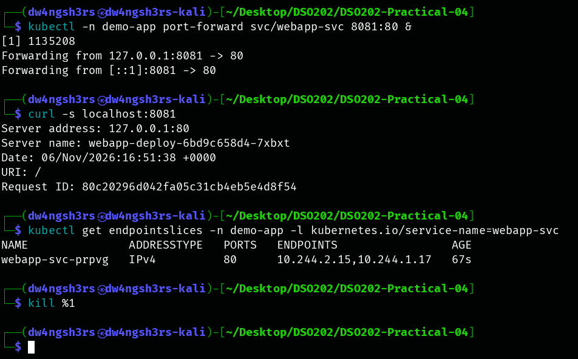

**Observation:** the deployed application really works. `nginxdemos/hello:plain-text` replies with the serving pod's name (`webapp-deploy-…-7xbxt`), and the Service's EndpointSlice lists both pod IPs (`10.244.2.15`, `10.244.1.17`), the same IPs as in screenshot 7. So `Healthy` matches a working workload.

### Task 6 — Scaling the GitOps way (2 → 4 replicas)

```
sed -i 's/replicas: 2/replicas: 4/' manifests/deployment.yaml
git diff
git commit -am "Scale webapp to 4 replicas"
git push origin master
argocd app get my-webapp --refresh | grep -E 'Sync Status|Health Status'     # = UI "Refresh"
argocd app get my-webapp | grep -E 'Sync Status|Health Status'
argocd app history my-webapp
kubectl get pods -n demo-app -o wide
```

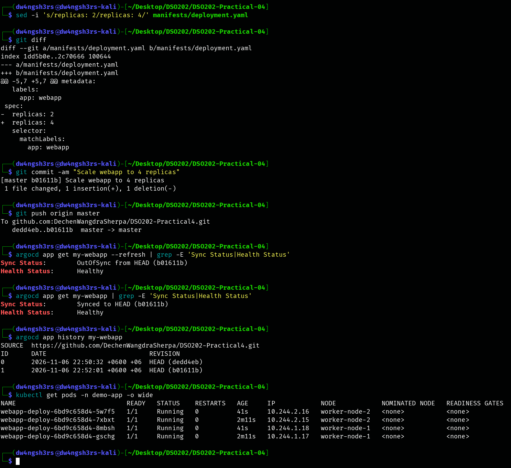

**Observation:** the only change I made was a one-line Git diff (`- replicas: 2` / `+ replicas: 4`), pushed as commit `b01611b`. A hard refresh (the UI's **Refresh** button, so I didn't have to wait for the 3-minute poll) caught the app at the moment of detection: **`OutOfSync from HEAD (b01611b)`** while still `Healthy`. The cluster was still running the old 2 replicas, but Git now said 4. Within seconds the automated sync applied it: the status became **`Synced to HEAD (b01611b)`**, `argocd app history` recorded a second sync (ID 1, revision `b01611b`), and two new pods (`41s` old, next to the original two at `2m11s`) brought the Deployment to 4, again spread over both workers.

### Task 7 — Self-healing against a "rogue admin"

```
kubectl scale deployment webapp-deploy -n demo-app --replicas=1
for i in 1 2 3 4 5 6; do echo "t+…s  <app sync/health>  <deployment>"; sleep 2; done
kubectl get pods -n demo-app
kubectl get events -n argocd --field-selector involvedObject.name=my-webapp --sort-by=.lastTimestamp | tail -6
```

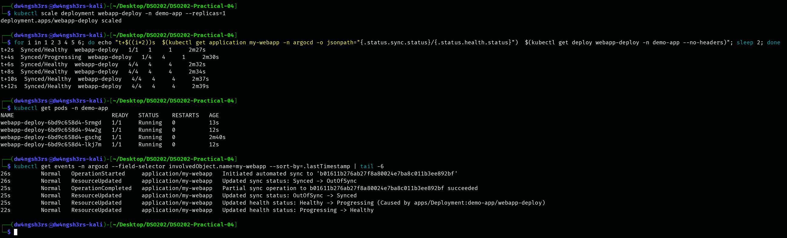

**Observation:** the manual `kubectl scale` took effect: at `t+2s` the Deployment was `1/1`, so three pods had been terminated. By `t+4s` Argo CD had already set it back to `4` desired (`1/4`, app `Progressing`), and by `t+6s` it was `4/4` and `Healthy` again. The three new pods are about 12 s old, and only the untouched `…-gschg` pod is older. The Application's events give the controller's side: `Updated sync status: Synced -> OutOfSync`, then `Initiated automated sync to 'b01611b…'`, `Partial sync operation … succeeded` (only the drifted Deployment was re-applied) and `OutOfSync -> Synced`.

The drift lasted about one second, so my polling loop (which samples every 2 s) never caught the `OutOfSync` state itself; the events show it. This is `selfHeal: true` in practice: configuration drift made with `kubectl` doesn't survive, because Git says 4.

### Task 8 — Pruning a resource deleted from Git, and rolling back with `git revert`

```
kubectl get svc -n demo-app
git rm manifests/service.yaml
git commit -m "Remove webapp-svc (test prune)"
git push origin master
argocd app get my-webapp --refresh > /dev/null; sleep 10
argocd app get my-webapp | sed -n '/Sync Status/,$p'
kubectl get svc -n demo-app
```

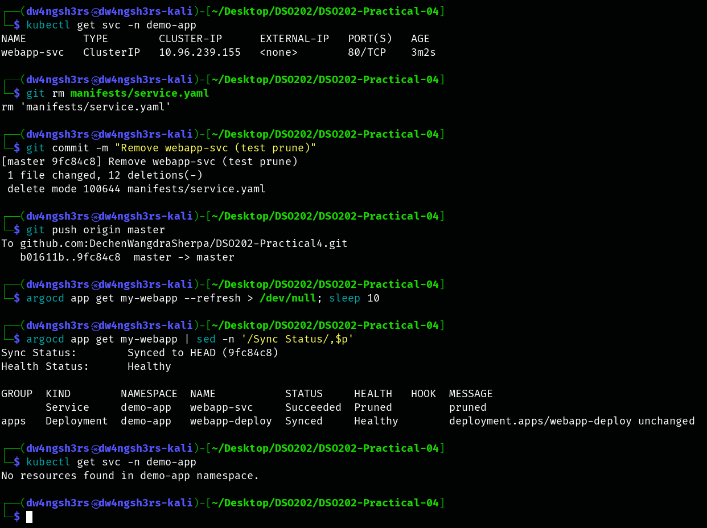

**Observation:** `webapp-svc` existed (ClusterIP `10.96.239.155`). After `service.yaml` was removed in commit `9fc84c8` and the app refreshed, Argo CD reported the Service as `Succeeded / Pruned`, with the message `pruned`, and the Deployment `unchanged`. `kubectl get svc` then found nothing in `demo-app`. Without `prune: true`, Argo CD would only have flagged the Service as an extra resource and left it running as a safety precaution.

```
git revert --no-edit HEAD
git push origin master
argocd app get my-webapp --refresh > /dev/null; sleep 10
argocd app get my-webapp | sed -n '/Sync Status/,$p'
kubectl get svc,endpointslices -n demo-app
git log --oneline --stat -5 | grep -v '^ *$'
argocd app history my-webapp
```

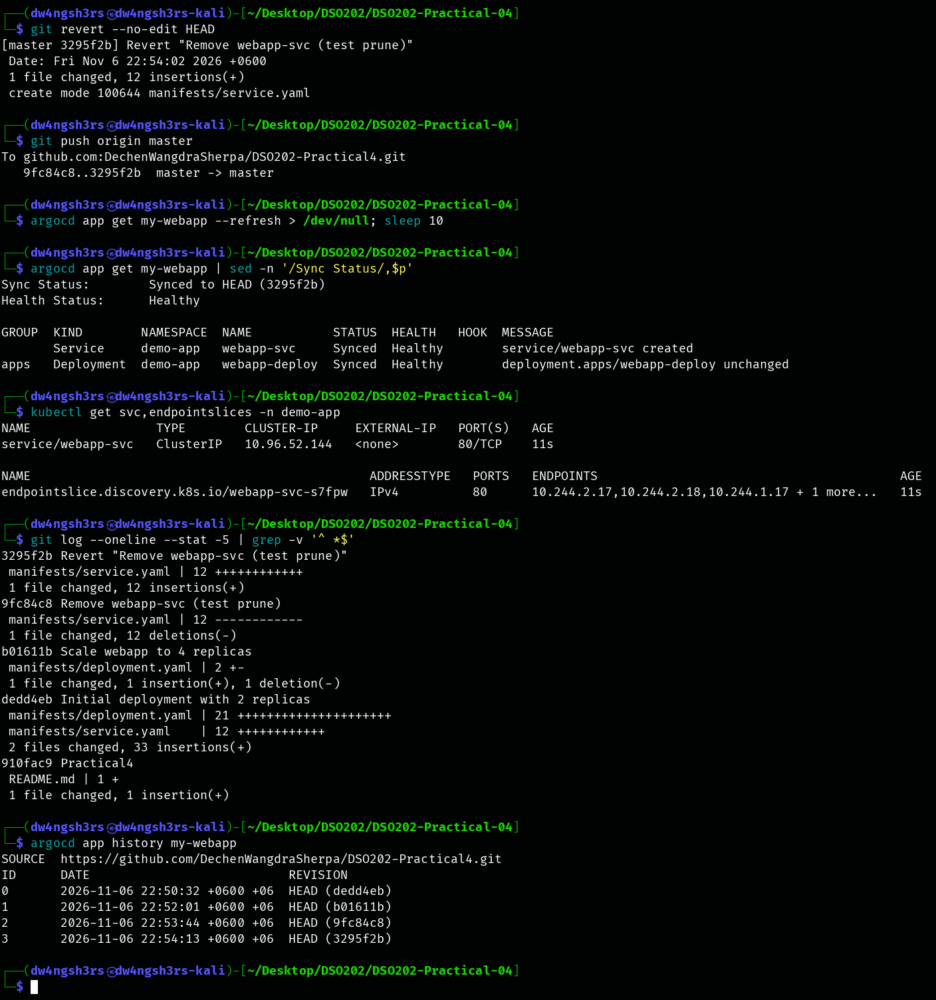

**Observation:** `git revert HEAD` didn't rewrite history. It created a new commit, `3295f2b Revert "Remove webapp-svc (test prune)"`, that adds the file back. After the push, Argo CD synced to `3295f2b` and recreated the Service (`service/webapp-svc created`), and its EndpointSlice selected all four pods. The restored Service has a **new ClusterIP** (`10.96.52.144` instead of `10.96.239.155`): a revert in Git recreates the declared *object*, but not runtime-assigned state such as an allocated IP. Clients should therefore use the DNS name `webapp-svc.demo-app`.

The two outputs side by side are the GitOps audit trail. `git log --stat` shows who changed what and why for each of the four lab commits, and `argocd app history` shows that each one was deployed (IDs 0–3, revisions `dedd4eb → b01611b → 9fc84c8 → 3295f2b`).

### Task 9 — Troubleshooting: reproducing a `ComparisonError`

```
grep -n 'path:' troubleshooting/broken-path-app.yaml
kubectl apply -f troubleshooting/broken-path-app.yaml
sleep 15; kubectl get applications -n argocd
kubectl get application broken-path-demo -n argocd -o jsonpath='{range .status.conditions[*]}{.type}: {.message}{"\n"}{end}'
kubectl delete -f troubleshooting/broken-path-app.yaml
kubectl get applications -n argocd
```

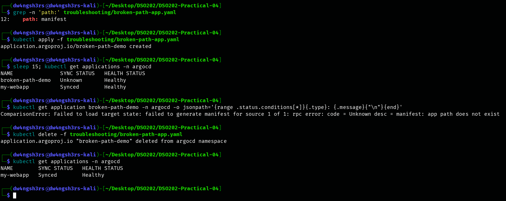

**Observation:** this checks the first row of the guide's troubleshooting table. A second Application pointing at the same repo with the misspelled path `manifest` (instead of `manifests`) shows **`Unknown`** sync status, and its condition is `ComparisonError: … manifest: app path does not exist`. Argo CD couldn't build a desired state, so it couldn't compare anything. The fix the table names (check that the `path:` folder name is spelled exactly right) is the cause here. Its health shows `Healthy` only because it owns no resources yet. I deleted the test Application afterwards; it never had automated sync, so it deployed nothing.

### Final state

```
argocd app list
kubectl get application my-webapp -n argocd -o jsonpath='{.spec.syncPolicy}' | jq -c .
kubectl get all -n demo-app
git status --short manifests; git log --oneline -1 origin/master
```

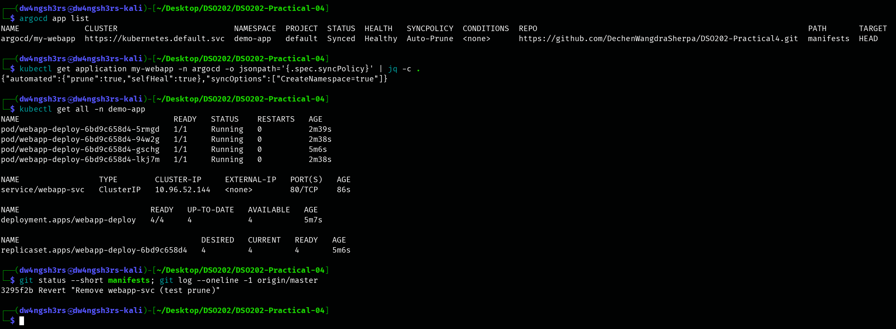

**Observation:** at the end, the only Application is `my-webapp`: `Synced`, `Healthy`, `Auto-Prune`, with no conditions, tracking `manifests` at `HEAD` of the public repo. The policy is exactly what was declared (`prune` and `selfHeal` true, `CreateNamespace=true`). The cluster matches Git: 4/4 pods, one ReplicaSet and `webapp-svc`. `git status` shows no uncommitted changes in `manifests/`, and `origin/master` is at the revert commit `3295f2b`, the same revision Argo CD reports as synced. The full Application object, rendered live manifests, sync history, events and git log are in `evidence/`.

---

## 4. Analysis

The guide has no numbered review questions, so this section answers the questions the guide itself raises, using what the tasks showed.

1. **Why does traditional push-based CI/CD break at scale?** (a) *Security:* the CI server holds cluster-admin credentials, so compromising CI compromises the cluster. In this lab no external system ever had cluster credentials: Argo CD ran inside the cluster and only needed *read* access to a public repo. (b) *No visibility after deployment:* once `kubectl apply` returns, CI stops watching. Argo CD keeps comparing, which is why it noticed my manual `kubectl scale` (Task 7). (c) *Configuration drift:* the cluster slowly stops matching the files. With GitOps, drift is detected (`OutOfSync`) and, with `selfHeal`, reversed.

2. **The four OpenGitOps principles, and where each appeared.** *Declarative*: only YAML facts in `manifests/` (Task 4). *Versioned and immutable*: every desired state is a commit hash (`dedd4eb`, `b01611b`, `9fc84c8`, `3295f2b`). *Pulled automatically*: the repo-server pulled from GitHub, and I never applied the manifests myself. *Continuously reconciled*: the self-heal in Task 7 and the automated syncs in Tasks 6 and 8.

3. **How does Argo CD relate to concepts I already know?** It is a **controller** running the same reconcile loop as the ReplicaSet controller, but its "desired" side comes from Git instead of etcd. Task 7 showed the two loops stacked: Argo CD restored `spec.replicas: 4` on the Deployment, and then the ReplicaSet controller created the 3 missing pods. It extends the API through **CRDs** (`Application`, `AppProject`, `ApplicationSet`, Task 2), which is why the app itself could be declared with `kubectl apply -f argocd-app.yaml`.

4. **Why keep application source and GitOps config in separate repositories?** To avoid CI loops (CI commits a new image tag to the config repo, and that commit must not trigger another build), to keep a clean audit trail (each config commit is a real deployment change), and for access control (developers vs. whoever may change production). In this lab one repo held both the report and the config, which only worked because Argo CD is scoped to `path: manifests`. Commits to `README.md` change no manifests, so the rendered desired state stays the same.

5. **What replaces `kubectl apply/edit/delete` in a GitOps workflow?** Git operations. To *deploy or scale*, edit and push (Task 6). To *peer-review*, use a pull request with the YAML diff. To *audit*, use `git log` / `git blame` (Task 8 `git log --stat`). To *roll back*, use `git revert <hash>` and push (Task 8). `kubectl` stayed a read-only debugging tool, except for the one deliberate "rogue" change in Task 7, which Argo CD undid.

6. **How does Argo CD learn about a new commit?** By **polling** every 3 minutes by default, or instantly through a **GitHub webhook** to the Argo CD server. In the lab, a manual **Refresh** (`argocd app get --refresh`) triggered the comparison immediately, which is why Task 6 caught the transient `OutOfSync from HEAD (b01611b)`. A public repo needed no credentials. A private repo would need a read-only PAT or SSH deploy key, which Argo CD stores as a Secret in `argocd`.

7. **What do the three main components do?** `argocd-server` serves the Web UI/CLI/API (Task 3). `argocd-repo-server` cloned the repo and rendered `manifests/`; its error is what surfaced as the `ComparisonError` in Task 9. `argocd-application-controller` compared rendered vs. live state and applied the fixes (the events in Task 7).

8. **Sync status vs. health status.** They are independent axes. *Sync* asks whether the cluster matches Git; *health* asks whether the app works. Task 6 showed `OutOfSync` + `Healthy` (Git changed, but the old pods were still fine). Task 7 showed `Synced` + `Progressing` (the fix was applied and new pods were starting). The final state is `Synced` + `Healthy`. `Synced` + `Degraded` would mean Git was applied faithfully but the pods crash, so the fix belongs in the YAML or the image, not in Argo CD.

9. **What do `selfHeal` and `prune` add to automated sync?** Plain automated sync applies new *commits*. **`selfHeal: true`** also re-applies Git when the *cluster* drifts (the manual scale to 1 was undone within about 4 s). **`prune: true`** deletes live objects whose manifests were removed from Git (the `webapp-svc` deletion in Task 8). Without prune, Argo CD keeps them as a safety precaution and just marks the app `OutOfSync`.

10. **How does a rollback work in GitOps, and what doesn't it restore?** `git revert` adds a new commit that reverses the bad one, so the history stays truthful and Argo CD applies the reversed state like any other commit (Task 8, history ID 3). It restores *declared* state only. The recreated Service came back with a different ClusterIP, and data held only in a deleted object (for example an un-retained volume) would not come back.

11. **Troubleshooting statuses.** `ComparisonError`: Argo CD can't read the repo or path (reproduced in Task 9: a wrong `path:` gives `Unknown` sync with `app path does not exist`). `OutOfSync` that stays stuck: auto-sync is off, or the API server rejects the YAML, and the sync status message shows the exact error. `Synced` + `Degraded`: the pods crash, so check pod events and logs. `Progressing` forever: the rollout can't finish, usually because of resources or `ImagePullBackOff`.

12. **Going further.** Argo CD renders **Helm** charts and **Kustomize** overlays natively (my Practicals 5 and 6 could be deployed this way, one Application per environment). The **App of Apps** pattern bootstraps many Applications from one parent Application pointing at a folder of `Application` YAMLs. **Secrets** must never be committed in plain text or base64 (base64 is encoding, not encryption; compare the admin Secret decoded in Task 3). Use Sealed Secrets or the External Secrets Operator instead.

---

## 5. Reflection

The moment that made GitOps "click" for me was Task 7. I ran an ordinary `kubectl scale --replicas=1`, kubectl replied `scaled`, and two seconds later the Deployment was already back at four. The command hadn't failed: it was overruled. The Application's events showed exactly what happened (`Synced -> OutOfSync`, `Initiated automated sync`, `Partial sync … succeeded`). With GitOps, the real way to change production is a commit, and the commit history became my deployment log (`argocd app history` lined up one-to-one with `git log`).

The first real problem was not in the lab steps but in my cluster. `kubectl get pods -A` showed `kube-proxy` in `CrashLoopBackOff` with 70+ restarts and CoreDNS not Ready. The kube-proxy log line `failed complete: too many open files` pointed to the host's inotify limit (`max_user_instances = 128`) being used up by other containers running on the same Docker daemon. If I had installed Argo CD straight away, its pods could not have reached services or resolved GitHub, and the failures would have looked like Argo CD problems. I couldn't raise the sysctl without sudo, so I stopped the unrelated `floci` containers and recreated the kube-proxy pods. Checking cluster health *before* a lab is now part of my routine.

The second mistake was trusting the guide's install command as written. `kubectl apply -f install.yaml` printed a long list of `created` lines, and it would have been easy to miss the last one: the `applicationsets.argoproj.io` CRD was rejected because its last-applied annotation exceeded 256 KiB. Re-applying with `--server-side --force-conflicts` fixed it, and I kept the failing log in `evidence/`. I also learned to read a status at the right moment: my first scale-up capture showed `OutOfSync` because I looked before the automated sync had run, so I waited for the sync and captured the `Synced` state as well. Next time I would add a GitHub webhook or keep the 3-minute poll in mind, instead of reading `OutOfSync` as a failure.
